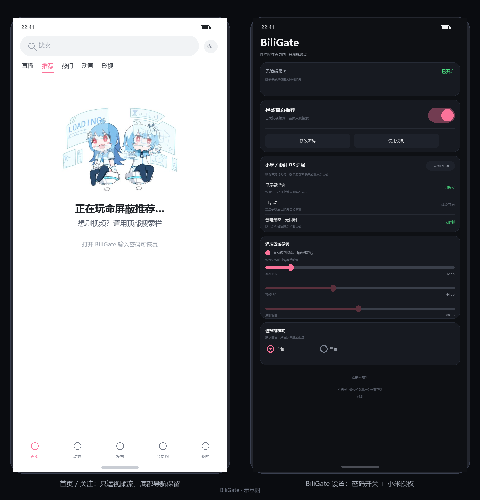

# BiliGate · 哔哩哔哩首页闸

只遮视频流：**首页和「关注」里的视频列表被盖住，顶部搜索栏、顶部标签栏、底部导航都还能用；切到「我的」完全不遮**。遮挡框是「两个小人 + LOADING」的样式，可在白色 / 黑色两套之间切换（默认白色）。想关掉拦截，必须回到 BiliGate 输入 4–8 位数字密码。



> 应用没有联网权限，密码和设置只保存在本机；不修改、不重打包哔哩哔哩，不需要 root / Xposed。

---

## 它做了什么

| 页面 | 表现 |
| --- | --- |
| 首页 / 关注 的视频流 | 列表区域被遮罩盖住，不能点、不能滑、不能下拉刷新 |
| 顶部搜索栏、顶部标签栏 | **保留可点**，可以切标签、可以搜索 |
| 底部导航（首页/动态/发布/会员购/我的） | **保留可点**，永远不被遮 |
| 「我的」页面 | 完全不遮，和平时一样 |
| 搜索页 / 视频页 | 完全不受影响 |
| 想恢复 | 打开 BiliGate → 输入密码 → 关闭「拦截首页推荐」 |

遮罩是一层不透明深色视图，带一把锁和提示文字，只覆盖内容列表那一块，触屏事件全部被它吃掉，所以没法再从首页点进推荐视频。

## 为什么是"伴侣 App"而不是改哔哩哔哩

改 APK 需要重打包、破坏签名，还要 root + Xposed/LSPosed，升级即失效、风险高。BiliGate 用系统自带的无障碍图层实现同样的效果：装一个独立 App、开一次无障碍权限即可，哔哩哔哩本身不动。

---

## 小米 / 澎湃 OS 必做的 3 步

小米把无障碍图层也当作「悬浮窗」管理，这三项不做，遮罩可能不显示、重启后也可能失效。BiliGate 首页有一张「小米 / 澎湃 OS 适配」卡片，点每一行可以直接跳到对应系统页面，右侧会显示当前状态（✅ 已授权 / ⚠️ 未授权）。

1. **显示悬浮窗** —— 应用设置 → 应用管理 → BiliGate → 权限管理 → 显示悬浮窗。没有它，小米上遮罩直接不出现。
2. **自启动** —— 设置 → 应用设置 → 授权管理 → 自启动管理，把 BiliGate 打开。重启后无障碍服务才能被系统重新拉起。
3. **省电策略 → 无限制** —— 应用设置 → BiliGate → 省电策略，选「无限制」。否则后台被清掉后拦截会悄悄失效。

然后开启无障碍：**设置 → 更多设置 → 无障碍 → 已下载的应用 → BiliGate → 开启**。

> 如果这个开关是灰的：Android 13 起对"侧载安装"的应用有「受限设置」，去 **应用信息 → 右上角 ⋮ → 允许受限制的设置**，再回来开启即可。

> HyperOS 2 的路径基本一致；如果某一行提示"未授权"，回到系统设置手动找同名开关即可。

---

## 构建 APK

本仓库不含编译好的 APK（二进制不入库），三种构建方式任选：

### 方式 A：GitHub Actions（不需要本地环境）

两种上传方式**二选一，不要同时传**：

- **A1 只传压缩包**：仓库根目录只放 `BiliGate-source.zip`，再在网页上新建 `.github/workflows/build-from-zip.yml`（内容就是本仓库里同名文件）。流水线会自动解压再编译。
- **A2 传解压后的工程**：把本目录全部文件（含 `.github/`）上传，用自带的 `build-apk.yml`。注意 `.github` 在 Windows 资源管理器里是隐藏文件夹，要先勾「显示隐藏的项目」。

然后打开仓库的 **Actions** → 左侧 `build-apk`（或 `build-from-zip`）→ **Run workflow**，完成后在该次运行底部下载 `BiliGate-debug`，解压得到 `app-debug.apk`，传到手机安装。

### 方式 B：Android Studio

`File → Open` 选择本目录，等待 Gradle 同步，然后 `Run` 或 `Build → Build APK(s)`，产物在 `app/build/outputs/apk/debug/`。

> 仓库里没有放 `gradle-wrapper.jar`（二进制不方便入库）。Studio 提示 "Gradle wrapper not found" 时，选右侧的 *Use Gradle from: 'wrapper' / 指定本地 Gradle*，或在终端跑一次 `gradle wrapper` 生成即可。

### 方式 C：命令行

需要 JDK 17、Android SDK（platform 34 + build-tools）和 Gradle 8.7+：

```bash
export ANDROID_HOME=/path/to/Android/Sdk
gradle :app:assembleDebug
# 产物：app/build/outputs/apk/debug/app-debug.apk
```

---

## 安装与首次使用

1. 安装 APK（小米会提示"未知来源"，允许本次安装即可）。
2. 打开 BiliGate → 点「去开启无障碍服务」→ 在列表里找到 BiliGate 并开启。
3. 打开「拦截首页推荐」→ 设置 4–8 位数字密码。
4. 按提示把小米那三项也授权。
5. 打开哔哩哔哩：首页只剩搜索栏。

**试用建议**：先只开无障碍、不设密码，确认遮罩位置对（搜索栏没被挡住、首页确实点不动）之后，再设密码开启拦截。位置不对就去「顶部留白微调」手动调。

## 密码规则

- 4–8 位数字，SHA-256 + 随机盐存储，明文不落盘。
- 连续输错 5 次锁定 30 秒。
- 忘记密码只能清除应用数据或卸载重装（密码和开关会一起重置）——这是刻意的，否则这层锁就没有意义。

---

## 工作原理

```
AccessibilityService 收到窗口 / 内容变化
        │
        ├─ 活跃窗口不是哔哩哔哩            → 撤掉遮罩
        ├─ 不是 *MainActivity              → 撤掉遮罩（搜索页/视频页等）
        ├─ 没有顶部搜索栏，或选中的是「我的/动态/消息/会员购」
        │                                   → 不是视频流，不遮
        └─ 是视频流 → 盖住「内容列表」那一块：
              上沿 = 搜索栏或标签栏之下
              下沿 = 底部导航之上
```

- 遮罩用 `TYPE_ACCESSIBILITY_OVERLAY`，由无障碍服务直接添加，不需要 `SYSTEM_ALERT_WINDOW`（小米除外，见上）。
- 遮罩的高度是算出来的，不是铺满全屏：先找搜索栏（顶部）、再找内容列表（`RecyclerView`/`ViewPager` 等）和底部导航条，取交集。所以底部导航、顶部标签栏永远是露出来的。
- 判断“要不要遮”的两道门：① 有没有那条搜索栏；② 底部选中的 tab 是不是「我的/动态/消息/会员购」。任意一条说明不是视频流，就不遮。
- 遮罩窗口是 `FLAG_NOT_FOCUSABLE` 的：吞掉触摸但不抢输入焦点，所以返回键、手势导航、键盘都正常。
- **前台判定看「活跃窗口」**：每次判定都用 `AccessibilityWindowInfo.isActive()` 找出真正在前的应用窗口（用窗口 id 映射包名），而不是只看最近一条无障碍事件。遮罩自己产生的窗口事件、状态栏/输入法/系统弹窗事件都不会再让遮罩误撤。
- 切底部 tab 不换 Activity，所以内容变化（`TYPE_WINDOW_CONTENT_CHANGED`）也会触发重新判定，450ms 节流。
- 遮罩盖上后 0.9 秒自检一次，万一被别的东西撤掉会补回来（最多补 3 次，避免死循环）。
- 总开关每次判定时从 SharedPreferences 读取，改完立刻生效。

## 遮罩闪一下就消失 / 不出现 / 位置不对？

先看设置页「无障碍服务」卡片里的**「最近识别」**这一行：

| 显示内容 | 说明 |
| --- | --- |
| `tv.danmaku.bili.ui.main2.MainActivity` 之类 | 识别正常。遮罩还是不显示 → 99% 是没给「显示悬浮窗」，或系统拦了无障碍图层 |
| 别的类名（`Search`、`HomeActivity`、`…`） | 这个版本的首页 Activity 名字不在白名单里，把这一行发我，我加上 |
| 「暂无」 | 无障碍服务根本没收到窗口事件：确认服务是开启状态、没被系统限制 |

位置不对（比如底部导航上方露了一条缝、或「我的」也被盖住）时，去「遮挡区域微调」：

- **底部下探**（自动模式）：遮罩比导航条再往下盖多少，专门用来压掉导航条上方那条透明缝；
- **顶部留白 / 底部留白**（关掉自动识别后）：按绝对值手调。

> v1.2 起只盖内容列表，底部导航和「我的」不再受影响。
> v1.1 修复过一次「闪一下就消失」：遮罩自己加窗口时会产生一条窗口事件，旧代码把它当成"用户切走了"，于是把遮罩撤掉。现在改成按活跃窗口判定，并加了自检补回。

## 已知限制

- 哔哩哔哩各版本首页布局不同，自动识别可能偏几 dp，用「遮挡区域微调」修正。
- 遮罩只挡触摸，不改变视频自动播放行为（首页封面流一般不会自动播）。
- 从通知、桌面快捷方式、外部链接直接进视频页不受影响——需求只要求"首页不能直接点进去"。
- 底部导航的“发布 / 会员购”等页面本身不遮，如果这些页面里也有视频流，需要的话告诉我再加规则。
- 小米清理后台仍可能停掉无障碍服务；被停掉时 BiliGate 顶部会显示「未开启」，重新开启即可。
- **小米每次覆盖安装/更新 APK 后，系统可能自动关掉无障碍服务**，需要回「设置 → 无障碍」重新打开一次；改了包名或签名更会如此。
- 极少数 MIUI 版本会限制第三方无障碍图层，若三项权限都给了遮罩仍不出现，试试在开发者选项里关闭「MIUI 优化」后重启。
- 部分机型开启无障碍时会弹系统确认框，属正常现象。

---

## 目录

```
biligate/
├── app/src/main/
│   ├── AndroidManifest.xml
│   ├── java/com/biligate/
│   │   ├── MainActivity.java              # 设置页：密码开关、小米授权、遮挡区域微调
│   │   ├── GateAccessibilityService.java  # 遮罩 + 搜索栏/列表/底部导航识别
│   │   ├── GatePrefs.java                 # 开关状态 + 加盐 PIN
│   │   └── MiuiUtils.java                 # 小米系统页跳转与状态检查
│   └── res/                               # 布局、图标、文案
├── tools/make_assets.py                   # 生成图标与示意图
├── tools/validate.py                      # 校验 XML 与资源引用
└── .github/workflows/build-apk.yml        # 一键出 APK
```

## 自检

```bash
python tools/validate.py     # XML 是否合法、资源引用是否都存在
python tools/make_assets.py  # 重新生成图标和 docs/preview.png
```

## 遮挡框样式

遮挡框默认是白色，画面用的是你给的那张 2233 娘 LOADING 插画 + 「正在玩命屏蔽推荐…」。设置页「遮挡框样式」可以切白色 / 黑色两套：

- **白色**：直接用原图铺在白底上，和页面无缝；
- **黑色**：插画是白底线稿，直接放黑底会糊成一块，所以做成一张白色圆角卡片托住插画，四角透明，看起来像浮在遮罩上。

> 插画来自哔哩哔哩（2233 娘），版权归 B 站所有，只放在自己手机上用，别分发。

## 版本

- **1.3** 遮挡框换成「两个小人 + LOADING」样式，支持黑/白两套；新增「底部下探」微调，修掉导航条上方露缝；修复「我的」页面遮罩不消失（ViewPager 缓存的首页被判成当前页）；底部留白不再被强制拉回 40dp。
- **1.2** 只遮内容列表：底部导航、「我的」页面完全不受影响；顶部标签栏保持可点；新增「底部留白」微调；切 tab 时按内容变化重新判定。
- **1.1** 修复「遮罩闪一下就被撤掉」：前台判定改为活跃窗口 + 窗口 id 映射包名；去掉按输入框焦点让行的逻辑；遮罩盖上后自检并补回；设置页新增「最近识别」诊断行。
- **1.0** 首版。

仅供个人自用。
